<div align="center">

# ⚡ Antigravity Skill Forge

### **2,530+ Production-Grade Skills. 10 Master Super-Hubs. 5 Autonomous Subagents.**
### **Only 12.5% Token Budget Used.**

[](https://nodejs.org)
[](./package.json)
[](#the-10-master-super-hubs)
[](#-the-problem-vs-the-super-hub-breakthrough)
[](#-built-in-security-shield)
[](./LICENSE)

<p align="center">
  <b>Supercharge Google Antigravity with 2,530+ specialized engineering runbooks, 10 Master Domain Super-Hubs, and 5 Autonomous Subagents — with zero context bloat.</b>
</p>

[Quick Start](#-1-command-quick-start) •
[Why Super-Hubs?](#-the-problem-vs-the-super-hub-breakthrough) •
[10 Master Hubs](#-the-10-master-super-hubs) •
[5 Elite Subagents](#-5-autonomous-elite-subagents) •
[Security Shield](#-built-in-security-shield) •
[Web Command Center](#-interactive-web-command-center)

</div>

---

## 💥 The Problem vs. The Super-Hub Breakthrough

When you install 100+ standalone skills into `~/.gemini/config/skills/`, Google Antigravity loads every skill's frontmatter into the global system prompt. At ~130 skills, you hit the hard wall:

> ❌ **`Customization token budget exceeded (22,864 / 20,000 tokens). Large customizations will be truncated.`**

**Antigravity Skill Forge** solves this permanently using a **Hierarchical Progressive Disclosure Architecture**:

| Metric | Traditional Flat Skills (~130) | ⚡ Antigravity Skill Forge (2,530+) |
| :--- | :---: | :---: |
| **Active Skills & Runbooks** | ~130 | **2,530+ Specialized Runbooks** |
| **System Prompt Token Usage** | `22,864 / 20,000` (**114.3% — Broken**) | **`2,506 / 20,000` (12.5% — Healthy)** |
| **Free Context Budget** | `0%` (Truncated) | **87.5% Free for Reasoning** |
| **`SKILL.md` File Size** | Often `> 24 KB` (Truncated) | **`1.3 KB – 2.4 KB` (10x below ceiling)** |
| **Prompt-Injection Protection** | None | **Automated Security Shield Sanitizer** |

---

## 🏗️ How Progressive Disclosure Works

Instead of registering 2,530 top-level skills, Skill Forge registers **only 10 lightweight Master Super-Hubs** in the global index. All 2,530+ deep engineering runbooks live inside `references/*.md` and are loaded **on demand** (`0 tokens` at rest):

```mermaid
flowchart LR
    subgraph Sources["🌍 Multi-Domain Engineering Catalogs"]
      S1["Enterprise Architecture & Security"]
      S2["Core Web Vitals & Full-Stack"]
      S3["AI/LLM Systems & Data Pipelines"]
      S4["Product Strategy & QA Automation"]
    end

    subgraph Engine["⚙️ Skill Forge Engine"]
      A1["Implicit Trigger Synthesizer\n(3rd-Person Gemini Format)"]
      A2["Security Shield Sanitizer\n(Anti-Prompt Injection & RCE)"]
      A3["Weighted Semantic Classifier"]
    end

    subgraph Runtime["🚀 Google Antigravity Runtime"]
      H["10 Master Super-Hubs\n(Only 12.5% Token Budget)"]
      I["references/INDEX.md\n(Domain Catalog)"]
      R["2,530+ Markdown Runbooks\n(Loaded on-demand via view_file)"]
    end

    Sources --> A1 --> A2 --> A3 --> H --> I --> R
```



---

## ⚡ 1-Command Quick Start

**Zero external dependencies** (`100% native Node.js >= 20`). Works out of the box on **Windows, macOS, and Linux**.

```bash
# 1. Clone the repository
git clone https://github.com/Ederules/antigravity-skill-forge.git
cd antigravity-skill-forge

# 2. Run the Monster Bootstrap (Builds 10 Super-Hubs, installs 5 Subagents & harvests 2,530+ skills)
npm run bootstrap
```

In under 60 seconds, your Antigravity IDE / CLI is supercharged across all your workspaces.

---

## 🏛️ The 10 Master Super-Hubs

| Super-Hub ID | Runbooks | Core Technologies & Playbooks Covered |
| :--- | :---: | :--- |
| **`hub-ai-ml-agentic-mastery`** | **836** | LLM orchestration, Gemini API, LangGraph, RAG pipelines, vector search, embeddings, evals, academic research |
| **`hub-product-growth-strategy`** | **483** | SaaS growth loops, technical SEO, conversion rate optimization (CRO), landing pages, pricing, A/B testing |
| **`hub-database-data-mastery`** | **272** | PostgreSQL tuning, SQLite, MySQL, MongoDB, Redis, Prisma, dbt, BigQuery, schema migrations, `EXPLAIN ANALYZE` |
| **`hub-frontend-mobile-mastery`** | **242** | React 19, Next.js 15 App Router, Vue, Tailwind CSS, Shadcn, Flutter, React Native, iOS/Android, WCAG 2.2 a11y |
| **`hub-security-compliance-mastery`** | **232** | OWASP Top 10 defense, penetration testing, red teaming, Solidity smart contract audits, SOC2, GDPR, HIPAA |
| **`hub-backend-api-mastery`** | **140** | FastAPI async, NestJS, Express, Go, Rust, REST, GraphQL, gRPC, OAuth2/JWT, WebSockets, rate limiting |
| **`hub-devops-cloud-mastery`** | **125** | Multi-stage Docker, Kubernetes, Helm, Terraform, GitHub Actions CI/CD, AWS/GCP, Cloudflare, SRE observability |
| **`hub-testing-qa-automation`** | **123** | Playwright E2E, Cypress, Vitest, Jest, TDD Red-Green-Refactor loops, Chrome DevTools debugging, mocking |
| **`hub-architecture-clean-code`** | **47** | SOLID principles, Clean/Hexagonal Architecture, DDD, cyclomatic complexity reduction, ADRs, legacy refactoring |
| **`hub-scraping-reverse-eng`** | **30** | Headless browser scraping, anti-bot mitigation, network payload inspection, resilient typed SDK generation |

---

## 🤖 5 Autonomous Elite Subagents

Running `npm run bootstrap` also installs the **`antigravity-elite-agents`** plugin into `~/.gemini/config/plugins/`, unlocking 5 specialized subagents that can be spawned in parallel via `invoke_subagent`:

1. **`@architecture-reviewer`**: Audits module boundaries, SOLID compliance, circular dependencies, and cyclomatic complexity.
2. **`@security-red-team-agent`**: Performs adversarial OWASP Top 10 audits, IDOR/injection detection, and outputs exact remediation diffs.
3. **`@qa-systems-tester`**: Executes unit/integration/E2E suites, verifies live HTTP endpoints, and prevents regressions.
4. **`@web-performance-auditor`**: Diagnoses Core Web Vitals (LCP, INP, CLS), render-blocking assets, and layout shifts.
5. **`@code-modernizer`**: Extracts business rules from legacy code, maps version deltas, and executes safe upgrades.

---

## 🛡️ Built-In Security Shield

Harvesting thousands of community skills from public repositories carries inherent risks of hidden prompt injections or destructive shell snippets. Every single skill processed by **Antigravity Skill Forge** passes through [`src/core/security-sanitizer.js`](./src/core/security-sanitizer.js):

- **Unicode & BiDi De-obfuscation**: Strips zero-width and bidirectional control characters (`\u200B-\u200F`, `\u202A-\u202E`, `\uFEFF`) used to hide instructions from human reviewers.
- **HTML Comment Injection Stripping**: Purges hidden `<!-- ... -->` blocks containing system prompt overrides or secret exfiltration keywords.
- **RCE & Exfiltration Neutralization**: Detects and redacts remote shell pipes (`curl | bash`, `irm | iex`), destructive wipes (`rm -rf /`), and `.env` / `.ssh/id_rsa` exfiltration patterns.
- **Static Markdown Only**: Never downloads or executes third-party `.sh`, `.py`, `.js`, or binary hook files.
- **Hardened Local Server**: Binds exclusively to `127.0.0.1`, enforces strict localhost CORS, `Content-Security-Policy`, `X-Frame-Options: DENY`, immediate stream destruction on oversized payloads, and `Object.hasOwn` prototype-pollution guards.

---

## 🖥️ Interactive Web Command Center

Launch the local visual dashboard to browse all 2,530+ runbooks, monitor real-time token telemetry, inspect MCP servers, or inject custom skills with zero global token cost:

```bash
npm start
```
Open **[http://localhost:4040](http://localhost:4040)** in your browser.

---

## 🛠️ CLI Reference

```bash
# Full one-command installation (10 Super-Hubs + 5 Subagents + 2,530+ Skills)
node bin/skill-forge.js bootstrap

# Live token budget telemetry & Super-Hub distribution
node bin/skill-forge.js stats

# Instant search across all 2,530+ reference runbooks
node bin/skill-forge.js search <keyword>

# Convert & inject any GitHub URL or local file into a Super-Hub (0 global token cost)
node bin/skill-forge.js inject <github_url_or_file_path> [custom-name]

# Diagnose configured MCP servers (stdio & HTTP)
node bin/skill-forge.js mcp test

# Run the unit & security test suite
npm test
```

---

## 📂 Project Structure

```text
antigravity-skill-forge/
├── bin/
│   └── skill-forge.js           # CLI entrypoint (bootstrap, stats, search, inject, mcp)
├── docs/
│   ├── ARCHITECTURE.md          # Deep dive into Progressive Disclosure & Token Math
│   └── SECURITY.md              # Security Shield specification & threat model
├── src/
│   ├── core/
│   │   ├── adapter.js           # Implicit trigger synthesizer & 3rd-person normalizer
│   │   ├── explorer.js          # Live token telemetry, instant search & hub injector
│   │   ├── installer.js         # Global & workspace skill filesystem manager
│   │   ├── mass-harvester.js    # Multi-repo concurrent harvester & semantic classifier
│   │   ├── mcp-manager.js       # MCP server config manager & stdio health tester
│   │   ├── monster-builder.js   # 10 Super-Hub definitions & 5 Elite Subagents installer
│   │   ├── parser.js            # YAML frontmatter parser & GitHub raw URL resolver
│   │   └── security-sanitizer.js# Anti-prompt-injection & RCE sanitizer shield
│   ├── public/
│   │   └── index.html           # Interactive Web Command Center UI
│   └── server.js                # Hardened native HTTP server (127.0.0.1)
├── tests/
│   └── converter.test.js        # 10 automated unit & security tests
├── CONTRIBUTING.md              # Guide for adding new skill repositories
├── LICENSE                      # MIT License
└── package.json
```

---

## 📄 License

Released under the [MIT License](./LICENSE). Star ⭐ this repository if it supercharged your Antigravity workflow!
